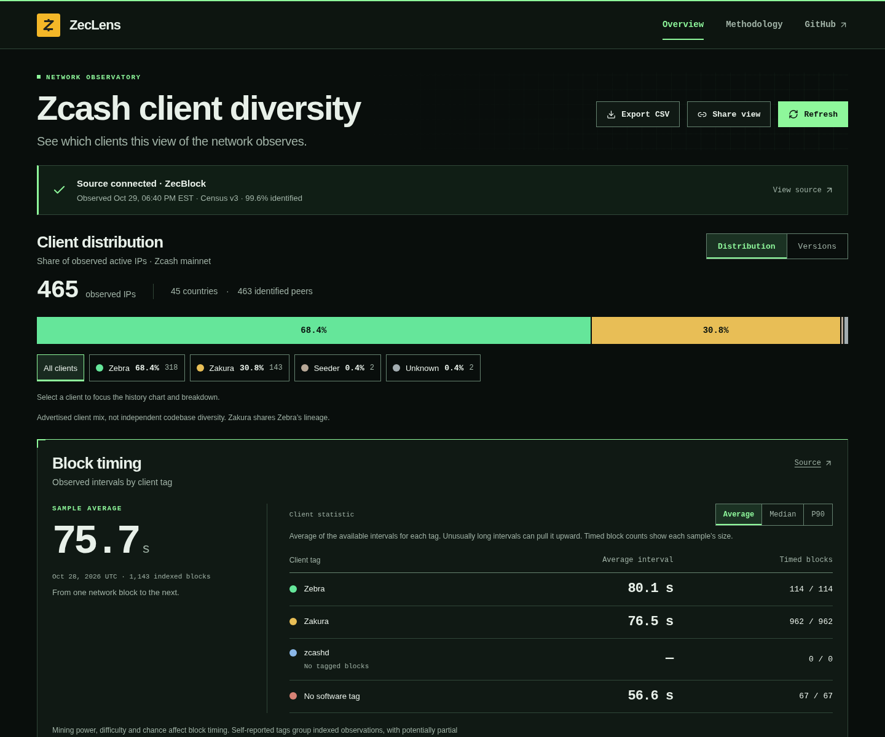

# ZecLens — Zcash client diversity

**Live:** [zeclens.dev](https://zeclens.dev)

A source-backed dashboard for the advertised clients observed on Zcash mainnet. It shows current client shares, compatible historical shares, and the source’s top reported versions, with CSV export and explicit data coverage.

Select a client from the distribution or chart legend to focus the history and table. Hover or tap the timeline to inspect a recorded sample, or use the keyboard slider and Previous/Next controls. Table headers sort clients and node counts; CSV follows the displayed grouping, filter and order. **Share view** copies the client focus, range, grouping, sort and timing statistic into a link that also works with browser Back/Forward. Timeline inspection is temporary and does not change the shared link or trigger network requests.



## Run locally

Requires **Node.js 24 or newer**.

```sh
npm ci
npm run dev
```

Open `http://127.0.0.1:5173`. Vite forwards `/api` to the Node server at `127.0.0.1:3001`.

```sh
npm test
npm run build
npm start
```

The production server serves the built dashboard and its API at `http://127.0.0.1:3001`. Set `HOST` and `PORT` to change the binding. Bind `HOST=0.0.0.0` only when deliberately exposing the service. Node's environment-proxy support preserves configured `HTTP_PROXY` / `HTTPS_PROXY` routing where present.

## Data and methodology

The backend reads ZecBlock’s public mainnet endpoints, without API keys:

- `https://api.zecblock.com/v1/network/nodes/stats`
- `https://api.zecblock.com/v1/network/nodes/history?period=7d` (or `30d`)

Requests go through the same-origin backend because upstream restricts browser origins. Reads happen on page load, period changes, or manual refresh, with a 60-second in-memory cache and bounded timeouts. Concurrent requests for the same resource coalesce. There is no crawler or scheduled polling. A failed request keeps any last successful data visible with an error; an empty server cache produces an unavailable state.

**These are observed active unique IPs, not all nodes, operators, or mining share.** The census combines local peers and chain-qualified crawler responses. Client names are self-reported; Zakura forks Zebra, so advertised client mix is not independent implementation diversity. Seeders and unknown clients remain in the full denominator. The version view contains at most 12 upstream client/version pairs and may not sum to 100%.

Observation time comes from `stats.lastUpdated`, not API response generation time. The UI marks current observations older than 15 minutes as delayed. History uses the source’s v3 route contract and excludes explicit non-v3 points. The source filters v3 in SQL even though its API omits per-point version fields. Missing intervals and incompatible versions are not connected in the plot. Thirty requested days can have fewer available observations.

See [API research and provenance](docs/API-SOURCES.md) for verified endpoints, source implementation links, and excluded sources.

## Project structure

- `src/components/`: distribution table, historical chart, methodology
- `src/lib/`: validated census types/parsers, chart preparation, UI fetch state
- `server/`: fixed-route upstream proxy and static production server
- `tests/`: data integrity, chart gaps, CSV, caching, and server boundaries
- `design/`: visual reference and implementation tokens

Production domain: https://zeclens.dev. The www hostname redirects to the apex; https://zeclens.vercel.app remains available as a hosting fallback. The repository includes a Vercel Web handler in `api/dashboard.ts`, which reuses the local server’s data validation. Successful public API responses have a 60-second Vercel CDN cache with a 120-second stale-while-revalidate window. In-process last-good data and request coalescing are best effort per function instance; a cold start can have no cached data. No analytics, wallet connection, account system, or secret is required.

## Block timing

The highlighted timing view groups observed block-header intervals by the self-reported client tag on each winning block. It uses the previous UTC-day window for every client and lets you switch between average, median and 90th-percentile intervals, with timed/returned sample counts. The network sample average stays visible for context. These observations depend on mining power, difficulty, chance and header timestamps. They are not controlled measurements of client processing or block-template generation speed.

`/api/block-timing` reads every matching indexed block through fixed ZecBlock cursor URLs, rechecks its first-page anchor, and discards incomplete or inconsistent captures. It has a 15-second total deadline, a five-minute per-instance cache and bounded CDN caching that expires by UTC midnight. Coverage can be partial if the upstream index is behind. The route creates no scheduled work. See [timing sources and methodology](docs/PERFORMANCE-SOURCES.md).
